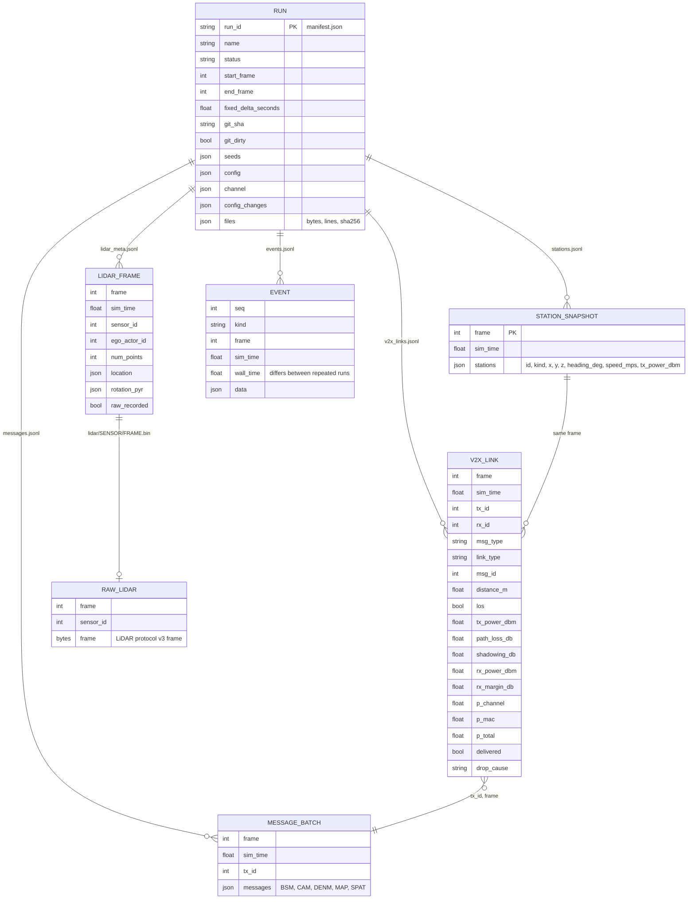

# Run data model

A recorded run is a directory `runs/<run_id>/` (see `docs/running.md` for how to make one). There is no
database: every file is plain text or a documented binary frame, written by `src/recording/recorder.py`
and described by `manifest.json` (schema version 1).

## Files

| File | One line per | Written when `record` contains | Reproducible byte for byte |
|---|---|---|---|
| `manifest.json` | run | always | no (wall-clock start/end, git state) |
| `events.jsonl` | event (run start/stop, DENM, LiDAR, config) | always | no (`wall_time`) |
| `stations.jsonl` | V2X update (2 Hz by default) | `stations` | yes |
| `v2x_links.jsonl` | evaluated sender→receiver link | `links` | yes |
| `messages.jsonl` | sender and V2X update | `messages` | yes |
| `lidar_meta.jsonl` | LiDAR frame | `lidar_meta` | yes |
| `lidar/<sensor>/<frame>.bin` | LiDAR frame | `raw_lidar` | yes (wall time is written as 0) |

Reproducible means: on the fake CARLA backend, two runs of the same scenario give identical sha256 for those
files (tested in `tests/e2e/test_scenarios.py`). On real CARLA this is **not verified**; see
`docs/science/limitations.md`, "Reproducibility of runs".

`manifest.json` holds, among others: `git.sha`/`git.dirty`, `seeds` (world, DSRC channel, penetration RNG),
the full `config` and DSRC `channel` parameters, every hot `config_changes` entry with the frame it took
effect, library versions, and `files` with bytes, line count and sha256 of each written file.

## Link record fields

`delivered` is the outcome after drawing against `p_total = p_channel × p_mac`. `drop_cause` is `null` when
delivered, otherwise `channel`, `mac` or `out_of_awareness_range`. `los` is the line-of-sight decision the channel used. Units: metres, dBm, dB, seconds.

## Previous version

Earlier revisions of this file described a relational schema (`SIMULATION_RUN`, `DSRC_CONFIG`, …) that no
code ever implemented. It was replaced by the file layout above (decision D6 of the refactor).
